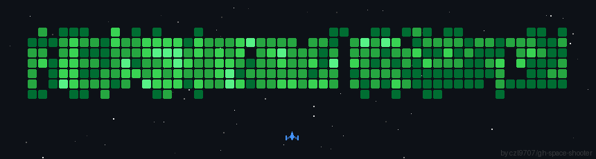

 
###    hello world! Gloria here👋

I lead an engineering team at a fast growing startup 🚀   
I take pride in understanding complex systems and coming up with actionable solutions in the midst of chaos.

My digital garden 🌱  
https://glorialim.com/portfolio

)

<!--  -->

<!-- 
 
-->

 

<!--
**glowiep/glowiep** is a ✨ _special_ ✨ repository because its `README.md` (this file) appears on your GitHub profile.

Here are some ideas to get you started:

- 🔭 I’m currently working on ...
- 🌱 I’m currently learning ...
- 👯 I’m looking to collaborate on ...
- 🤔 I’m looking for help with ...
- 💬 Ask me about ...
- 📫 How to reach me: ...
- 😄 Pronouns: ...
- ⚡ Fun fact: ...
-->

  ***
### 🛠 &nbsp;Tech Stack

**Frontend Development:**  
`React` `Typescript` `Tailwind CSS` `Chakra UI` `daisyUI` `Material-UI` `Bootstrap` `jQuery` `SASS` 

**Backend Development:**  
 `Node.js` `Express.js` `AJAX` `EJS` `Rails`
 
 **Databases:**  
 `PostgreSQL ` `Microsoft SQL Server`

**Version Control:**  
 `Git` `GitHub`

**Testing:**  
 `Cypress` `Jest` `Mocha` `Chai` `RSpec`

**Cloud Hosting Services:**  
 `AWS` `IBM Cloud` `Railway`
 
**Others:**  
 `Visual Studio Code` `Google Analytics` `FlowiseAI` `Figma` 

<!-- 

&nbsp;
&nbsp;
&nbsp;
&nbsp;
&nbsp;
\
&nbsp;

&nbsp;
&nbsp;
&nbsp;

&nbsp;
&nbsp;
\
&nbsp;
\
\
&nbsp;
&nbsp;

-->

<!--
**Languages and Tools:**

  

  <code></code>   
  <code></code> 
  <code></code> 
  <code></code> 
  <code></code>
  <code></code> 
  <code></code> 
  <code></code>

  

  

 -->
------
<!-- 
 
 
  
 -->

<!--  -->
  
  

 
